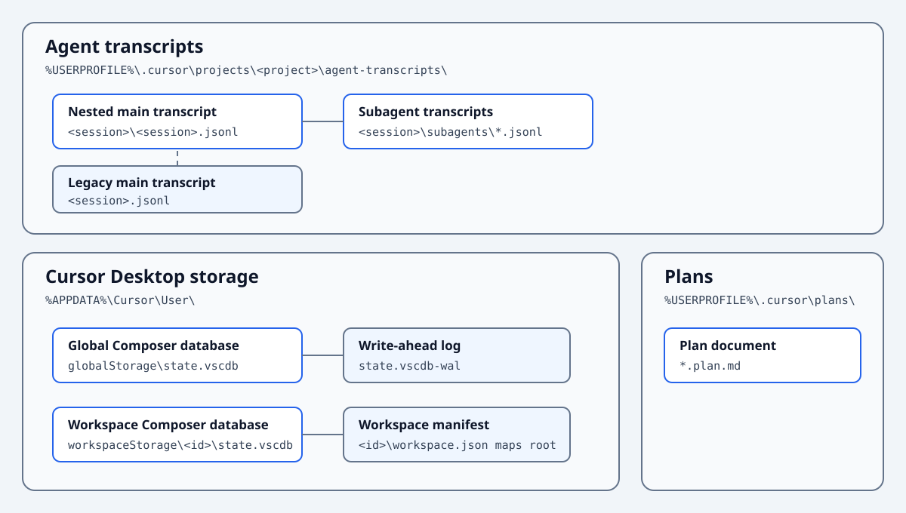
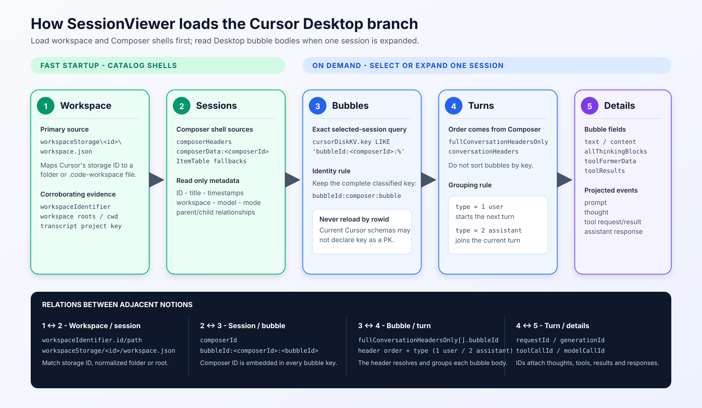
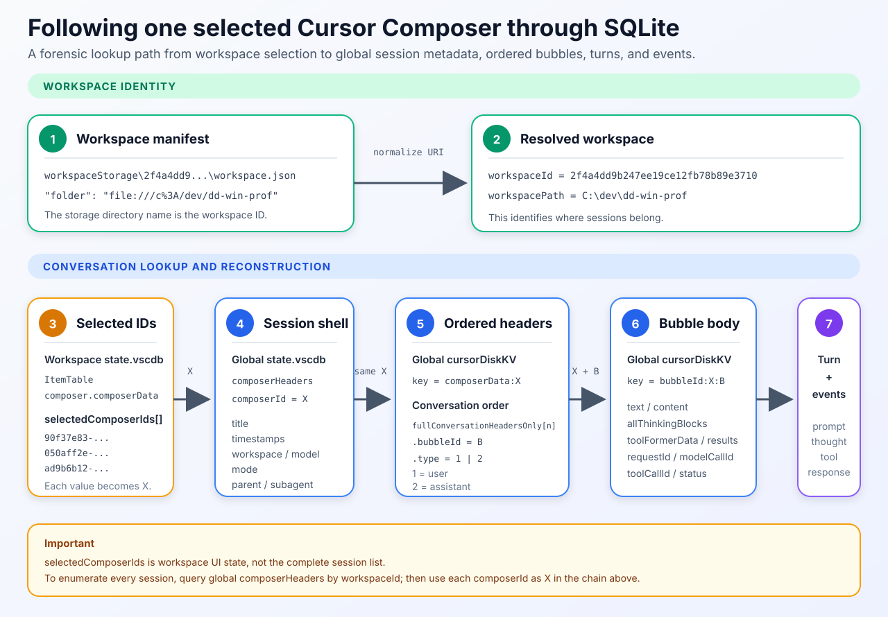

The first five posts examined agent harnesses (the programs that run AI coding agents) **while they were running**. A hook is a callback that Cursor, Claude Code, or Copilot invokes when something happens. Those hooks supplied the structure, and the previous post used the transcript path reported by a hook to fill a few gaps.

That live approach answers “what is my agent doing now?” The live approach does not help when I open Cursor a week later and ask two different questions:

- What happened in that previous session?
- Where is the plan I created during this session?

I use plans a lot, and finding one again was surprisingly difficult. Cursor stores a plan separately from the conversation that created the plan. Cursor can also split the conversation between a JSONL transcript (a text file with one JSON object per line) and SQLite (the embedded database used by Cursor Desktop).

This is the sixth post in the series, and the first of three about local history:

1. [Spying on Cursor: agent hooks, payloads and a simple observer](/posts/2026-08-23_spying-on-cursor-hooks/)
2. [Rebuilding the Agent conversation: sessions, turns, thoughts, tools, MCP, skills and summaries](/posts/2026-09-14_rebuilding-cursor-conversation/)
3. [Spying on Claude Code: more lifecycle events, different blind spots](/posts/2026-09-20_spying-on-claude-code-hooks/)
4. [Spying on GitHub Copilot twice: CLI hooks versus VS Code](/posts/2026-09-27_spying-on-github-copilot-twice/)
5. [Beyond hooks: enriching live sessions with undocumented transcript logs](/posts/2026-10-09_beyond-hooks-transcript-logs/)
6. **SessionViewer and Cursor: reconstructing history from JSONL, SQLite and plans** (this post)
7. SessionViewer and Claude Code: transcripts, subagents, usage and plans
8. SessionViewer and Copilot CLI: decoding events.jsonl, turns, usage and plans

## Where Cursor keeps the evidence

Cursor does not keep sessions in one authoritative file: they are spread across transcripts, Desktop state and plan files:



Cursor's Desktop SQLite stores contribute Composer IDs, titles, request IDs, and bubbles. Desktop SQLite and JSONL transcripts can describe the same conversation and even the same tool call. SessionViewer therefore reconciles matching records instead of concatenating them. Plan files supply current content, while transcript activity supplies ownership and historical evidence.

## A different application for a different question

`SessionViewer` is a separate desktop application in HarnessSpy with a read-only history scanner. It is not another mode of `CursorSpy.App`.

HarnessSpy also includes `CursorDBNavigator`, a separate Cursor-only application that explains how SQLite rows become workspaces, Composers, bubbles, turns, and events. SessionViewer remains the history browser; CursorDBNavigator is the physical-evidence browser introduced later in this post.

The Spy applications receive hook payloads through a named pipe, which is a local Windows communication channel. For example, a Cursor hook sends a JSON payload to `CursorSpy.App`, and that payload can identify a transcript. The Spy application inspects a transcript only after an accepted hook points to the file. The hook sequence still determines record order and correlation (which records belong to the same session or tool call).

SessionViewer uses a different path. It:

- scans files and databases owned by Cursor, Claude Code, and Copilot CLI directly;
- scans only the harnesses selected in its filter;
- refreshes those sources only at startup or after an explicit user action;
- rebuilds sessions even when HarnessSpy was not running at the time;
- reloads raw source records only when the inspector or a deep search needs them;
- connects a plan to the session that created it when the stored evidence identifies one session;
- can place a workspace-less session or unbound plan under a likely workspace.

SessionViewer does not read HarnessSpy hook payloads or transcript sidecars, which are copies that the live Spy applications preserve beside their own data. The live pipeline has an `ObservationReconciler`, a component that combines hook notifications with transcript rows. SessionViewer does not call that component. Cursor needs a different reconciliation step described later in this post because a transcript and the Desktop database can each describe the same tool call.

Here, a provider means one agent harness, such as Cursor, Claude Code, or Copilot CLI. A provider scanner reads one provider's local files and creates normalized `SessionCatalogEntry` records. SessionViewer keeps the latest complete result from each enabled scanner as a cached catalog. The catalog merger combines compatible entries, plan binding associates plans with sessions, and workspace inference can change where an unresolved entry is displayed in the UI.

SessionViewer projects the catalog into a lazy tree. A lazy tree creates child nodes only when the user expands a session or turn. For example, a collapsed session with thousands of events initially occupies one session node and one **Expand to load** placeholder.

A `SessionCatalogEntry` is not a Cursor, Claude, or Copilot record. It is SessionViewer's normalized representation of one session, with turns, events, related files, metadata, and source provenance. Provenance points back to the original evidence, such as a JSONL byte range or a SQLite table and key. The inspector follows that origin only when raw content is requested. The catalog keeps reloadable references instead of retaining every raw JSON string in application memory. Claude and Copilot can also provide session-level events, such as a saved copy of a system prompt.

SessionViewer adds evidence labels that do not exist in the provider files. `Observed` means that a source states a value directly. `Corroborated` means that independent sources agree, such as a transcript and a Desktop record for the same tool call. `Derived` marks a deterministic value that SessionViewer calculated from source data. For example, Cursor transcript turns are `Derived` because SessionViewer constructs their IDs from the session identity and turn number. `Heuristic` marks a useful but uncertain match. `Opaque` means that an action is visible but its complete result is not. `Ambiguous` means that more than one match remains possible. `Unavailable` means that the provider files contain no usable evidence for that value.

In SessionViewer, the harness filter controls both scanning and display. Disabling Cursor removes Cursor sessions from the tree and evicts its cached catalog. Enabling Cursor again requests a cache-aware Cursor refresh. A cache-aware refresh compares the current provider file snapshot with the previous complete snapshot and reuses the retained catalog when those inputs have not changed. SessionViewer rescans if the cache was evicted or the file snapshot changed. An option named **Keep disabled provider cache** preserves that catalog when faster toggling matters more than memory.

## Refreshing only when I ask

SessionViewer scans the saved enabled harnesses once at startup. After that scan, only three actions can request another refresh:

- **Refresh** or F5 revalidates the enabled harnesses;
- **Force full refresh** ignores the source cache;
- selecting a harness revalidates the newly enabled provider.

A normal refresh first captures a recursive snapshot of the relevant file paths, lengths, and modification times under each provider root. If that snapshot matches a previous complete scan, SessionViewer reuses the cached provider catalog. **Force full refresh** bypasses that comparison. No `FileSystemWatcher`, recovery timer, process inventory, or background refresh queue exists, so SessionViewer is deliberately not a live view.

Cursor Desktop calls an IDE agent conversation a **Composer** and assigns it a Composer ID. A database can contain years of Composer history. Loading every old conversation body before showing the first workspace would delay the first useful result. If a cache-aware refresh finds no catalog change, SessionViewer updates the scan status without rebuilding the tree.

The first load is progressive. SessionViewer reads lightweight Desktop Composer shells without loading their SQLite bubble bodies. A shell contains metadata such as the Composer ID, title, timestamps, workspace, model, mode, and parent relationship. JSONL transcripts are parsed in parallel and can already contributeto  complete turns. 

Cursor loading has two lazy layers. First, expanding a Cursor session loads that Composer's Desktop SQLite bubbles and merges the new evidence with any transcript-derived turns already in the catalog. SessionViewer calls this detail loading and conversion **hydration**, then reruns Cursor turn and event reconciliation. Second, the WPF tree creates child view models only for expanded sessions and turns. A collapsed session or turn contains one **Expand to load** placeholder. Collapsing the node removes those event view models from memory but keeps the hydrated catalog entry. Hovering or selecting a session can calculate its summary without creating every descendant first.



This diagram isolates the Cursor Desktop SQLite branch. The JSONL transcript scan runs in parallel and can contribute turns before Desktop bubble hydration. 

## Cursor writes more than one history

SessionViewer currently reads these Cursor-owned locations:

| Source                  | Default location                                                                       |
| ----------------------- | -------------------------------------------------------------------------------------- |
| Current transcript      | `%USERPROFILE%\.cursor\projects\<project>\agent-transcripts\<session>\<session>.jsonl` |
| Legacy transcript       | `%USERPROFILE%\.cursor\projects\<project>\agent-transcripts\<session>.jsonl`           |
| Child agents            | `...\<session>\subagents\*.jsonl`                                                      |
| Global Desktop state    | `%APPDATA%\Cursor\User\globalStorage\state.vscdb`                                      |
| Workspace Desktop state | `%APPDATA%\Cursor\User\workspaceStorage\<id>\state.vscdb`                              |
| Workspace manifests     | `%APPDATA%\Cursor\User\workspaceStorage\<id>\workspace.json`                           |
| Plans                   | `%USERPROFILE%\.cursor\plans\*.plan.md`                                                |

When both transcript layouts exist for the same project and session, SessionViewer uses the nested transcript and ignores the legacy flat copy.

SessionViewer enumerates all of the workspace manifests independently, including a storage directory that no longer contains `state.vscdb`. Those manifests provide the known roots used for workspace inference. Cursor plan discovery is currently limited to the top level of `%USERPROFILE%\.cursor\plans`; workspace-local plan directories remain disabled until an observed `isProject: true` artifact establishes that layout.

The two conversation sources complement each other:

- **JSONL transcripts** are close to Cursor's agent stream. Cursor rows can contain prompts, assistant text, thinking, tool requests, results, and child-agent files. Many rows omit IDs or timestamps.
- **SQLite state** contains Cursor Desktop Composer records. Cursor can store titles, workspaces, selected Composer IDs, request IDs, parent/child agent relationships, and conversation bubbles. A bubble is Cursor's stored record for one user or assistant message. The SQLite schema is private and changes between Cursor versions.

The next sections use both Cursor-native and SessionViewer terms. A native value is written by Cursor rather than created by SessionViewer. Cursor calls one IDE conversation a **Composer** and writes its native `composerId`. A **conversation header** is a lightweight ordered reference to one Cursor bubble. SessionViewer converts those Cursor records into a normalized **session** containing **turns** and **events**. A turn is one user prompt and the work caused by that prompt. An event is one normalized prompt, thought, tool request, result, or assistant response.

A sparse transcript can look like this:

```json
{"role":"user","message":{"content":[{"type":"text","text":"<user_query>inspect the project</user_query>"}]}}
{"role":"assistant","message":{"content":[{"type":"thinking","thinking":"Inspect two areas."},{"type":"tool_use","id":"call-1","name":"Read","input":{"path":"README.md"}}]}}
{"role":"assistant","message":{"content":[{"type":"text","text":"Done."}]}}
{"type":"turn_ended","status":"success"}
```

The fields in this example are Cursor transcript fields, not SessionViewer fields. The first Cursor `user` row starts the turn, the `tool_use` block requests a `Read`, and the Cursor `turn_ended` row closes the turn. The example contains enough information to build that group, but not enough to timestamp every block or identify the matching Desktop bubble.

## Following one selected Composer through SQLite

A concrete workspace makes the SQLite relationships easier to see. One Cursor workspace-storage directory on my machine was:

```text
%APPDATA%\Cursor\User\workspaceStorage\
    2f4a4dd9b247ee19ce12fb78b89e3710\
```

The directory name is Cursor's opaque workspace-storage ID. Its `workspace.json` contained:

```json
{
  "folder": "file:///c%3A/dev/dd-win-prof"
}
```

That manifest maps the storage ID to `C:\dev\dd-win-prof`. In the adjacent workspace `state.vscdb`, the `ItemTable` row whose key was `composer.composerData` contained this list of IDs:

```json
{
  "selectedComposerIds": [
    "90f37e83-0aa8-4d76-8e3a-094322899a3e",
    "050aff2e-6911-4c50-8886-6afb0c9b2323",
    "ad9b6b12-6295-48f6-b2a9-6ac755e7a855"
  ]
}
```

Each value is a `composerId`, so each value can identify one Cursor conversation/session. To investigate one selected composer/session manually, I called the ID `X` and followed matching records in the global database:

1. `composerHeaders.composerId = X` supplied a lightweight session shell with fields such as title, timestamps, workspace and parent relationship.
2. `cursorDiskKV.key = composerData:X` supplied the detailed Composer object.
3. `fullConversationHeadersOnly[n]` supplied the ordered bubble references. Each element contained a `bubbleId` and a `type`.
4. `cursorDiskKV.key = bubbleId:X:<bubbleId>` supplied the full bubble body.



This figure follows one selected Composer through one observed modern layout. 

The array position inside `fullConversationHeadersOnly` is the conversation order. Sorting `bubbleId:*` keys would sort UUID-like identities rather than messages. A `type` value of `1` identifies a user bubble, and `2` identifies an assistant bubble. Every user bubble starts a new SessionViewer turn. Assistant bubbles contribute thoughts, tool calls, results, or responses to the current turn until the next user bubble appears. If an assistant bubble appears before any user bubble, SessionViewer preserves that evidence in a synthetic turn with an empty prompt. A Cursor `requestId` or `generationId` supplies a stable turn identity when present; neither ID starts the turn.

The following read-only queries verify the three physical joins for one Composer:

```sql
PRAGMA query_only = ON;

SELECT *
FROM composerHeaders
WHERE composerId = '90f37e83-0aa8-4d76-8e3a-094322899a3e';

SELECT value
FROM cursorDiskKV
WHERE key = 'composerData:90f37e83-0aa8-4d76-8e3a-094322899a3e';

SELECT key, value
FROM cursorDiskKV
WHERE key LIKE
  'bubbleId:90f37e83-0aa8-4d76-8e3a-094322899a3e:%';
```

The similarly named containers serve different purposes. The `composerHeaders` table contains session-level rows. An `ItemTable` value named `composer.composerHeaders` can contain aggregate session summaries. Inside one detailed Composer, `fullConversationHeadersOnly[]` contains ordered bubble references. 

## Probing SQLite instead of trusting one schema

I could not assume that every `state.vscdb` had the same tables, columns, or keys. The SQLite reader therefore performs a capability probe: it checks what the database contains before choosing a query. The implementation currently recognizes these forms:

- `cursorDiskKV` is a Cursor key/value table. A `composerData:<composer-id>` key identifies one detailed Composer record, and a `bubbleId:<composer-id>:<bubble-id>` key identifies one bubble body.
- `ItemTable` is another key/value table. Values named `composer.composerHeaders` and `composer.composerData` can contain aggregate Composer summaries and data.
- `composerHeaders` is an alternative table layout with one Composer summary per row.
- An aggregate payload can be a JSON array, an object containing `allComposers[]`, `composerHeaders[]`, or `headers[]`, or one Composer object.
- One Composer can list ordered bubble references under `fullConversationHeadersOnly[]`, `conversationHeaders[]`, `fullConversation[]`, or `conversation[]`.

SessionViewer opens each database in read-only mode with a two-second command timeout. SQLite can place recent committed changes in a separate write-ahead log file, abbreviated WAL. When `state.vscdb-wal` is present and accessible beside `state.vscdb`, the read-only SQLite connection can consult that sidecar. SessionViewer does not copy or manage the WAL. An offline snapshot made by copying only the main database while Cursor is active can therefore omit recent committed data. A value larger than the active profile's per-record limit (4 MiB in Balanced or 16 MiB in Complete), malformed JSON, or an unsupported layout marks the scan as incomplete and adds a warning instead of aborting the whole catalog refresh.

This is archaeology rather than relying on a supported Cursor storage API.

## Making the reconstruction inspectable with CursorDBNavigator

SessionViewer answers “what happened in my local agent history?” Since I wanted to present how Cursor was storing the sessions/turns during conferences, I vibe coded a new companion application named **CursorDBNavigator** to answer a narrower question: “which physical Cursor row and which reconstruction rule produced this workspace, Composer, bubble, turn, or event?”

CursorDBNavigator is a separate Cursor-only WPF application in HarnessSpy. Its default **Reconstruction** tab follows four stages:

1. workspace;
2. Composer/session;
3. ordered bubbles;
4. turns, thoughts, tools and responses.

Startup uses the Desktop header scanner to create normalized workspace and Composer shells without bubble bodies. Selecting one session first indexes the `composerData:<id>` record and `bubbleId:<id>:*` rows for that Composer. Reconstruction then reloads the bounded JSON values by exact table and key and runs the same Desktop bubble-to-turn conversion used by SessionViewer. Selecting a bubble, turn, or event shows the applied rule, the relevant IDs, and a bounded raw-source preview. **Go to source bubble** moves from a turn or event back to the bubble that produced it. **Go to physical row** opens the exact SQLite table and key.

The separate **Physical storage** tab keeps the database visible as a database. It displays every discovered database and table, pages rows without loading an entire table into the grid, and shows columns, formatted JSON, and raw values. Known Cursor rows receive semantic inbound and outbound relations. A full store discovery can also correlate a SQLite row with a `workspace.json` manifest or a matching transcript. Missing and ambiguous relation targets remain visible instead of being silently guessed.

CursorDBNavigator does not replace SessionViewer. Its reconstructed tree uses the Desktop SQLite branch so that each logical node can stay attached to one physical row. It does not perform SessionViewer's full transcript/Desktop event reconciliation, plan binding, Claude or Copilot scanning, or presentation-only workspace inference. But it helps during conference demos  :^) 

## Inferring a likely workspace without changing identity

Conservative identity matching can leave a real session under **Unknown workspace**. A transcript directory can be encoded ambiguously, a Desktop record can contain only an opaque workspace ID, and a session can operate on files outside the repository in which it started. SessionViewer now treats “which session is this?” and “where should I display it?” as separate questions.

For a session with an unknown or synthesized multi-root workspace, `CursorSessionWorkspaceInferrer` builds candidates from every known `workspace.json` manifest and from the single-root workspaces already observed in the catalog. Cursor derives a project-directory key from a workspace path, so one encoded transcript directory can sometimes match one manifest path. The inferrer adds independently inspectable signals:

1. another record with the same native session ID and one known workspace scores 95;
2. one workspace whose Cursor project-key encoding matches the transcript directory scores 90;
3. a tool target or working path inside the most specific known root scores 75;
4. each root in a synthesized multi-root observation scores 70;
5. a rooted Windows path in the user prompt scores 65.

Child-agent target paths do not move their parent session. A provider-observed single-root workspace needs no inference, and explicit multi-root workspace data is left alone.

For each candidate, SessionViewer starts with its strongest signal and adds five points for every additional kind of evidence, capped at 99. A candidate needs at least 60 points. The winner also needs a 15-point lead; otherwise the result remains `Ambiguous`.

For example, a unique project-key match starts at 90. Independent tool-path evidence adds five points, producing 95. If the next candidate scores 75, the 20-point lead exceeds the required margin of 15, so the 95-point candidate wins. One cross-repository tool operation cannot by itself outweigh the matching project identity.

A clear winning candidate places the session under that candidate workspace with an amber `?` overlay. Competing candidates keep the session under **Unknown workspace** with an amber `~`. The inspector still shows the provider-observed workspace separately from the likely workspace, score, evidence and alternatives. Workspace inference does not change the catalog key, does not participate in session merging, and does not turn an inferred folder into provider fact.

## One tool call, observed twice

Merging sessions and turns is not enough. A transcript and a Desktop bubble can each contain the same logical tool request under different native names:

```text
Transcript:  Shell
Desktop:     run_terminal_command_v2
```

If I simply concatenated both event lists, the tree and dashboard would report two shell calls even though Cursor ran one.

`CursorSessionEventReconciler` is the Cursor-specific component that removes this second layer of duplication. `ToolCallId` is SessionViewer's normalized field for a provider-native tool-call identifier. A correlation key is SessionViewer's fallback grouping of equivalent tool categories or equivalent MCP server-and-tool identities. First in, first out (FIFO) means that the first unmatched transcript call is paired with the first unmatched Desktop call in the same group. The reconciler works inside each merged turn:

1. pair transcript and Desktop requests by an exact native tool-call ID, stored in SessionViewer's `ToolCallId` field;
2. when no ID exists, calculate a SessionViewer correlation key from the tool category or Model Context Protocol (MCP) server-and-tool identity, then pair calls first in, first out (FIFO) within that key;
3. create one SessionViewer event with the timing, status, duration and result linkage observed in the Desktop bubble;
4. preserve the tool name, arguments and assistant-row grouping observed in the transcript;
5. attach the other source record as supplemental provenance.

For example, suppose a transcript contains shell calls `T1` and `T2`, while Desktop contains equivalent calls `D1` and `D2`, and none has a native tool-call ID. All four calls receive the same SessionViewer shell correlation key. FIFO pairs `T1` with `D1`, then `T2` with `D2`. SessionViewer marks each combined event `Corroborated` and lists both origins in its provenance metadata without duplicating either call in the tree. The same pass removes duplicate assistant responses after collapsing leading, trailing, and repeated whitespace.

Many transcript rows have no timestamp. After the reconciler pairs a transcript tool request with a timed Desktop request, later transcript-only thoughts, responses, and the turn-ending row use the most recent paired Desktop time as a sorting hint. For example, if the paired Desktop request occurred at 10:03, an untimed transcript thought that follows the request can sort after 10:03. SessionViewer does not claim that Cursor timestamped the thought.

SessionViewer runs this reconciliation after the startup merge and again after session expansion adds Desktop bubble details. 

MCP tools need one more distinction. Cursor transcript records named `GetDynamicTools` and Desktop records named `get_mcp_tools` only discover which MCP tools are available. SessionViewer displays those records as ordinary tool calls but does not count them as MCP executions. A transcript `CallDynamicTool` record and the matching Desktop `mcp-<server>-<tool>` record represent an actual MCP execution, so reconciliation counts that execution once.

That difference fixed a very visible problem: discovering ten MCP tools must not become ten MCP executions in the Summary dashboard.

## Side chats and child agents

A Cursor side chat is a child Composer seeded with copies of turns from its parent. Cursor Desktop also stores background child Composers, while Cursor transcripts put child-agent logs in a `subagents` directory.

SessionViewer keeps a side chat as a separate session and uses Cursor's native `sideChatSeedTurnCount` value to remove the copied parent turns. For example, a value of `3` means that the first three side-chat turns are inherited copies and are removed from the side-chat session. For a background child, SessionViewer instead attaches the child's files and turns to the parent. The attached records retain the child Composer ID and type. When the transcript and SQLite sources both expose a relationship, SessionViewer removes inherited child or side-chat turns again before reconciling individual events.

SessionViewer does not invent a parent when Composer relationships form a cycle or refer to a missing Composer. The child remains visible as a separate session entry, and the scan reports a warning.

SessionViewer also removes empty, workspace-less Composer shells with no turns. Those unused “new chat” records otherwise add noise, while an orphaned session that contains conversation events remains visible.

## Reconnecting plans

Cursor plan files contain YAML front matter followed by Markdown. YAML front matter is the metadata block between the opening and closing `---` lines:

```yaml
---
name: Add session history
overview: Rebuild local sessions and plans
todos:
  - id: scan
    content: Scan provider files
    status: completed
isProject: false
---
```

These front-matter fields belong to Cursor's plan file. A file can also begin with an HTML comment containing a native session UUID, but SessionViewer treats that marker as a workspace hint rather than proof of ownership. Ownership still comes from transcript activity. SessionViewer binds a plan only when one of these conditions identifies exactly one session:

1. the session wrote or patched the plan's explicit `.plan.md` path;
2. a successful `CreatePlan` or `UpdatePlan` call from the session matches the plan's normalized `name`, `overview`, and todo ID/content pairs.

SessionViewer calls the second rule a structured match. The structured-match key comes from the plan's `name`, `overview`, and todo ID/content pairs, not its Markdown body. For example, a successful `CreatePlan` call with the same name, overview and todos as the file establishes one ownership candidate even if the current todo status has changed. Similar Markdown prose without the matching structured fields does not establish ownership. A failed or aborted plan call does not establish ownership. A read, search or prompt attachment is recorded as a reference, not as ownership. If two sessions remain candidates, SessionViewer leaves the plan unbound and adds its own `Ambiguous` label.

Revision history has similar limits. A successful structured `CreatePlan` or `UpdatePlan` call can preserve a complete plan body, and the current file supplies the latest complete body. Revisions compare the body rather than front-matter todo status. A file edit may expose only a patch, not the complete document after the patch. SessionViewer calls that update opaque because the source proves that an edit occurred but does not contain the complete resulting plan body. SessionViewer marks the revision history as partial instead of inventing an intermediate version.

An unbound plan can still receive a presentation-only workspace. SessionViewer considers a unique native session marker, a session whose prompt attached the plan, and rooted file links or inline paths in the plan document. All usable signals must resolve to the same observed workspace; conflicting evidence leaves the workspace unknown. A uniquely placed plan appears under that workspace in **Unbound plans (inferred)** with a `?` overlay, but it remains unbound. Plans without one likely workspace stay under **Orphan Plans**. Bound plans remain under their owning session, and the session icon receives a small plan-document overlay.

## Selected does not mean open

A recently modified file is not proof that a session is active. Neither is Cursor's persisted `selectedComposerId` or `selectedComposerIds` field. A selected Composer ID states which Composer was selected in Cursor when it wrote the workspace state. For example, the ID remains in `state.vscdb` after Cursor closes. SessionViewer exposes the Cursor-native selection as metadata; SessionViewer does not convert selection into an `Open` lifecycle state.

SessionViewer never enumerates processes or reads process command lines. Cursor transcript and SQLite entries therefore remain conservatively **Closed**. A Cursor transcript record whose `type` is `turn_ended` provides observed evidence that one turn ended; the record does not prove whether Cursor is still running. The absence of `turn_ended` does not change the session to **Open**.

When you select **Open Session** on a Desktop node, SessionViewer runs `cursor --reuse-window "<workspace>"`. The `cursor --reuse-window` command focuses or opens the workspace. Cursor exposes no supported public command that selects an arbitrary local Composer by ID inside that window, so SessionViewer does not claim that the exact conversation was selected. A Cursor Agent CLI entry can instead use `agent --resume=<session-id>` when its metadata identifies that CLI entry point.

## Three tools for three questions

The reconstruction work now needs three deliberately different tools:

- **SessionViewer** answers “what happened?” It combines provider sources into a normalized, reconciled history with plans and workspace placement.
- **CursorDBNavigator** answers “why does this interpretation exist?” It exposes the Cursor SQLite rows, keys, relations, reconstruction rules and source evidence behind one result.
- **Cursor Session Explorer** answers “how do I find or reopen this session inside Cursor?” It emphasizes navigation rather than a complete event timeline.

This work also led me to build **Cursor Session Explorer**, a Windows-first extension that runs inside Cursor but this will probably be the topics of another post.

## What remains uncertain

Cursor's passive history still has hard limits:

- transcript and SQLite formats are undocumented and version-dependent;
- transcript rows can lack timestamps, IDs, results, usage and skill evidence;
- likely-workspace placement can remain ambiguous when project, prompt and tool-path evidence disagree;
- event pairing falls back to FIFO when two calls have the same SessionViewer correlation key;
- child transcripts are scanned only one level below `subagents`;
- portable or alternate user-data roots, remote stores, and cloud agents are not covered;
- every discovery profile has finite limits, so the incomplete-scan warning matters.

Raw provenance can also contain prompts, source code, commands, results, and secrets. SessionViewer does not modify the provider files, but anyone who can use its inspector can read that stored content. The optional snapshot cache is compressed, not encrypted, so cached records need the same protection as the original files.

## Conclusion

Cursor history is not one transcript waiting to be displayed:

1. **Identity and placement are different decisions.** A matching Composer ID can join records only when the workspace also matches or no competing record exists. A likely workspace can organize an unresolved session without changing that identity.
2. **Turn merging does not remove event duplicates.** Transcript and Desktop tool requests must be paired again inside each turn.
3. **Plan ownership and plan placement are different too.** An explicit write path or one unique structured-content match can identify an owner; references and document paths can suggest a workspace but cannot bind the plan.
4. **Persisted selection does not prove that a session is active.** SessionViewer keeps Cursor sessions closed because a recent file or selected Composer cannot prove that a process still exists.
5. **Large history needs staged, reloadable evidence.** Startup reads Composer shells, session expansion loads Desktop bubbles, and the inspector reloads raw records only when needed.
6. **A logical reconstruction still needs a path back to physical evidence.** CursorDBNavigator keeps the workspace, Composer, bubble, turn and event views connected to the original database table and key.

The next post applies the same SessionViewer model to Claude Code, whose archive is split between prompt history, transcripts, subagents and plan artifacts.

## References

- [HarnessSpy source code](https://github.com/chrisnas/HarnessSpy)
- [Current SessionViewer and CursorDBNavigator architecture](https://github.com/chrisnas/HarnessSpy/blob/main/src/architecture.md)
- [Cursor session source implementation](https://github.com/chrisnas/HarnessSpy/tree/main/src/Shared/HarnessSpy.Core/Sessions/Cursor)
- [CursorDBNavigator application](https://github.com/chrisnas/HarnessSpy/tree/main/src/Apps/CursorDBNavigator)
- [Part 1: Spying on Cursor](/posts/2026-08-23_spying-on-cursor-hooks/)
- [Part 2: Rebuilding the Agent conversation](/posts/2026-09-14_rebuilding-cursor-conversation/)
- [Part 3: Spying on Claude Code](/posts/2026-09-20_spying-on-claude-code-hooks/)
- [Part 4: Spying on GitHub Copilot twice](/posts/2026-09-27_spying-on-github-copilot-twice/)
- [Part 5: Beyond hooks](/posts/2026-10-09_beyond-hooks-transcript-logs/)
