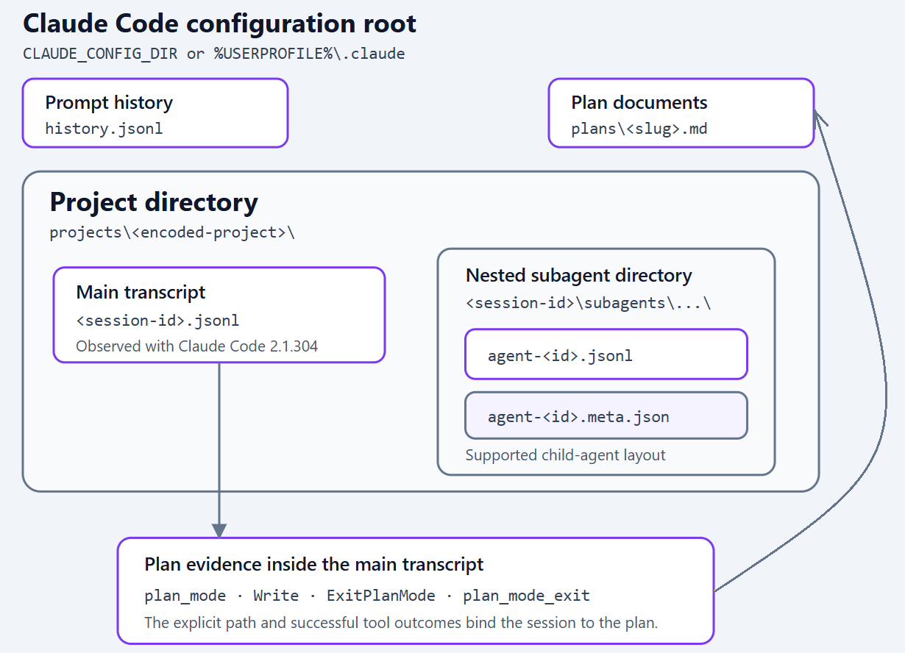

The [previous post](/posts/2026-11-15_sessionviewer-and-cursor/) introduced `SessionViewer`, the passive-history application that reconstructs a catalog of past sessions by scanning files that providers have already written. SessionViewer does not need hooks to collect that history. Cursor required two overlapping sources (agent transcript files and a Desktop SQLite database) plus a reconciliation pass that compared duplicate records before displaying them.

Claude Code has no corresponding SQLite database. At first, that sounds easier.

In practice, Claude's storage is not simpler. Claude Code can spread one session across global prompt history, a current transcript, short-lived child agents called subagents, and a Markdown plan stored elsewhere. Prompt history can outlive the detailed transcript, and transcript activity can survive after a plan file is heavily updated.

This is the seventh post in the series:

1. [Spying on Cursor: agent hooks, payloads and a simple observer](/posts/2026-08-23_spying-on-cursor-hooks/)
2. [Rebuilding the Agent conversation](/posts/2026-09-14_rebuilding-cursor-conversation/)
3. [Spying on Claude Code: more lifecycle events, different blind spots](/posts/2026-09-20_spying-on-claude-code-hooks/)
4. [Spying on GitHub Copilot twice: CLI hooks versus VS Code](/posts/2026-09-27_spying-on-github-copilot-twice/)
5. [Beyond hooks: enriching live sessions with undocumented transcript logs](/posts/2026-10-09_beyond-hooks-transcript-logs/)
6. [SessionViewer and Cursor: reconstructing history from JSONL, SQLite and plans](/posts/2026-11-15_sessionviewer-and-cursor/)
7. **SessionViewer and Claude Code: transcripts, subagents, usage and plans** (this post)
8. SessionViewer and Copilot CLI: decoding events.jsonl, turns, usage and plans

I will not repeat all the shared SessionViewer machinery from Post 6. The selected harnesses in the UI control which providers are scanned and cached. Scanning happens at startup or after **Refresh**, **Force full refresh**, or enabling a provider; there is no file watcher, periodic scan or process probe. This post starts with Claude Code's files.

## The `.claude` files family

Claude stores its files under `%USERPROFILE%\.claude` by default. The `CLAUDE_CONFIG_DIR` environment variable can override that complete configuration root. The main transcript files use JSON Lines (JSONL), a text format with one JSON record per line:



SessionViewer reads the transcript and subagent directories directly, in addition to the `history.jsonl` file that contains prompts from all sessions. Claude's **projects** are what we usually call **workspaces**. Claude stores them under subfolders of the `.claude\projects` directory. These subfolders encode workspace folders: for example, `C--github-chrisnas-MyRepo` can represent `C:\github\chrisnas\MyRepo`.

A project directory can also contain `sessions-index.json` and `.session_cache.json`. These optional metadata sources can preserve a session title, first prompt, timestamps, workspace candidates, and other session details after the main transcript disappears. They do not recreate missing assistant messages, tools, or turns. SessionViewer also reads subagent JSONL and `.meta.json` files recursively below a session's `subagents` directory.

SessionViewer scanner is deliberately separate from `ClaudeSpy.App`, the live hook viewer. ClaudeSpy learns transcript paths from Claude Code hook payloads, follows new lines as Claude writes them and can copy a short-lived subagent transcript into a HarnessSpy-owned companion file. SessionViewer instead scans the files that still exist under `.claude`. If Claude Code deletes a transcript or subagent file before a scan begins, SessionViewer cannot recreate its conversation rows. SessionViewer can recover a missing plan artifact only when transcript rows preserve explicit plan evidence, as described later.

## The main transcript stores the conversation

Claude Code stores each session conversation in a main `.jsonl` transcript file under a subfolder corresponding to a project or workspace:

```text
<root>\projects\<encoded-project-workspace>\<session-id>.jsonl
```

SessionViewer can discover this file without an index or cache entry. A transcript row can provide the native `sessionId`, current working directory (`cwd`), timestamps, prompts, assistant messages, tool calls, tool results, usage and plan activity.

The root-level `history.jsonl` is a separate file that stores prompts from all sessions. The `display` field contains the prompt, while `sessionId` identifies its session. Claude also uses that ID as the name of the `.jsonl` file in the project subfolder:

```json
{"display":"Please do this and that", "timestamp":1792482255511,"project":"C:\\github\\chrisnas\\MyRepo","sessionId":"12345678-1234-beef-beef-1234abcd5678"}
```

This record means that the prompt belongs to the discussion stored in `%USERPROFILE%\.claude\projects\C--github-chrisnas-MyRepo\12345678-1234-beef-beef-1234abcd5678.jsonl`.


## Joining main and subagent evidence

A workspace is the folder under which SessionViewer groups a session. Among the sources covered in this post, SessionViewer prefers Claude's `cwd` field from the normal main transcript. If that file does not supply `cwd`, SessionViewer tries one unique project path from `history.jsonl`, a successfully decoded project-directory name (for example, `C--repo` can represent `C:\repo`), and finally a subagent `cwd`. SessionViewer uses the `Unknown workspace` label when none of those sources supplies a usable path.

Because the main transcript outranks subagent evidence, a subagent that changes directory cannot move its parent session to another workspace.

SessionViewer merges a subagent transcript into its parent session by using the transcript's `parentSessionId` or `sessionId`, with the containing session directory as a fallback. In one Claude Code 2.1.330 session, two background agents also preserved exact parent-turn and parent-tool evidence:

```text
parent turn promptId=P
├── Agent tool_use id=t1
│   └── child agent A: promptId=P, meta toolUseId=t1
└── Agent tool_use id=t2
    └── child agent B: promptId=P, meta toolUseId=t2
```

The shared native `promptId` lets SessionViewer place both child transcripts in the parent turn without comparing timestamps. The child filenames and rows supply their `agentId`, while each `.meta.json` file supplies the exact parent `toolUseId`. SessionViewer currently keeps that tool ID as provenance rather than nesting the child transcript below the parent tool node.

This exact turn binding depends on the child records carrying the parent `promptId`. Records without a prompt ID inherit only within the same subagent file or remain in an `agent:<agent-id>:unscoped` turn. SessionViewer does not use timestamps as a fallback for parentage: timestamps only order reconstructed events and turns.

## Turns are built around `promptId`

Claude Code's strongest native key for a conversation turn is `promptId`. For example, the following observed human prompt is also the root of its transcript chain, so its `parentUuid` is null:

```json
{"parentUuid":null,"promptId":"6cb3a98c-b077-4caa-b2b3-be8546d76ada","type":"user","message":{"role":"user","content":"Do this and do that"}, "origin":{"kind":"human"},"cwd":"C:\\MyRepo","sessionId":"12345678-1234-beef-beef-1234abcd5678"}
```

The row repeats `sessionId` even though the same value usually appears in the `.jsonl` filename. SessionViewer checks both sources instead of assuming that they agree.

All actions (including tool calls) until the next prompt usually share the same `promptId`. A row with `user` as `type` can contain human text, a tool result, harness-generated text or a mixture of those forms. Only a row that SessionViewer identifies as a human prompt starts a turn.

`assistant`, `system` and `attachment` rows without a `promptId` inherit the last unambiguous prompt in the same file. Any row that still has no turn goes into a SessionViewer bucket such as `agent:<agent-id>:unscoped` or `session:<session-id>:unscoped`. SessionViewer does not silently attach that row to the nearest turn.

Claude's `uuid` and `parentUuid` fields are kept by SessionViewer: they describe the provider record chain, but SessionViewer does not treat that chain as the semantic parent/child tree shown in the UI. A null `parentUuid` identifies a chain root, not necessarily the first human prompt. Local commands typed by the user or other provider records can precede that prompt, and later prompts normally point to the preceding record.

### Not every `user` row is a human prompt

Claude Code also stores harness activity with `type:"user"` and `message.role:"user"`. For example, running the local `/model` command in Claude Code 2.1.317 produced three JSONL records with one `promptId`:

```json
{"type":"user","isMeta":true,"message":{"role":"user","content":"<local-command-caveat>...</local-command-caveat>"}}
{"type":"user","message":{"role":"user","content":"<command-name>/model</command-name>\n<command-message>model</command-message>\n<command-args></command-args>"}}
{"type":"user","message":{"role":"user","content":"<local-command-stdout>Set model to Opus...</local-command-stdout>"}}
```

The `local-command-caveat` record says that the command ran directly in Claude Code rather than being sent as a model request. The `command-name`, `command-message` and `command-args` elements describe the slash command. The `local-command-stdout` element contains the output displayed to the user, sometimes including terminal-formatting escape sequences. 

These angle-bracket elements are Claude Code's internal wrappers, not a documented XML contract. A typed or pasted prompt can also contain a wrapper such as `<pasted_content>`. In the transcript versions inspected for this post, `origin.kind:"human"` is the strongest provider marker for a human-originated turn. `promptSource`, `turnOrigin` and `turnPosition` can provide supporting evidence, but these internal fields vary between Claude Code versions. Neither `type:"user"`, `message.role:"user"` nor `userType:"external"` proves that the text was typed as a prompt.

SessionViewer currently excludes `isMeta:true` rows and separates `tool_result` blocks, but it does not yet filter every wrapper-only local-command record. A `command-name` or `local-command-stdout` row can therefore appear as a prompt. This is a known reconstruction limitation, not evidence that the user sent that text to the model.

Claude's tool IDs provide an exact join:

```text
assistant message
├── tool_use id=t1
└── tool_use id=t2

later user row
└── tool_result tool_use_id=t1
```

In these Claude-native blocks, `tool_use.id` identifies the tool and `tool_result.tool_use_id` points back to that request. SessionViewer uses the exact match to place the result under the same tool node.

Claude's assistant `message.id`, when present, becomes SessionViewer's assistant-step ID. If one assistant row contains several `tool_use` blocks, SessionViewer also creates one parallel-group ID for those tool calls. The UI then displays a group such as **Parallel · 2 calls**. The assistant-step and parallel-group IDs are SessionViewer concepts; Claude provides the message and tool-call IDs from which SessionViewer builds them.

## One set of transcript rules, two pipelines

Post 5 described the Claude transcript rows that enrich a live hook tree. SessionViewer reads many of the same row shapes. Duplicating every field rule would eventually make the live and passive applications interpret the same value differently.

HarnessSpy therefore has a shared interpreter named `ClaudeTranscriptSemantics`. The class translates provider-written fields into common HarnessSpy meanings without discovering files or building sessions. It handles:

- Model Context Protocol (MCP) tool names such as `mcp__github__search`, plus Claude's explicit MCP attribution fields;
- tool success, failure, denial and interruption;
- assistant usage fields and `cost-state` records;
- skill listings, activations and `Skill` tool calls;
- system-prompt snapshots;
- readable and opaque thinking.

Only field interpretation is shared. Discovery and correlation remain separate. `ClaudeSpy.App` starts from paths supplied by hook payloads and reconciles transcript evidence with a live hook tree. SessionViewer recursively scans Claude Code storage and adds the surviving records to its historical catalog tree.

The separation matters because the same JSON row can produce different behavior in the two applications.

## System prompts belong to the session

One useful Claude Code attachment type is `prompt_snapshot`, which provides evidence about the system prompt prepared for the model:

```json
{
  "type": "attachment",
  "attachment": {
    "type": "prompt_snapshot",
    "systemPrompt": "\nYou are an agent working with the user toward their goals, ..."
  }
}
```

SessionViewer accepts a `systemPrompt` value that is either one string or an array of strings. It converts line endings to `\n`, removes blank lines only from the outer edges and joins non-empty array entries with one blank line. SessionViewer then computes a SHA-256 content hash and stores the snapshot as a session-level event outside ordinary turns.

The tree displays those events in a **System prompts** group before the conversation. Snapshots with the same content hash and the same agent become one displayed revision with an occurrence count.

Storing snapshots at session level avoids two misleading views:

- repeating the same large prompt under every turn;
- counting prompt text as a response, thought or tool event.

When the content hash changes, the tree keeps a new **System prompt changed** node. 

The snapshots show the prompt text that Claude Code exposed locally, but they do not prove the exact request that reached Anthropic's server after every possible transformation.

## Thinking, tools and lifecycle rows

The `content` array in a Claude assistant message can contain:

- readable `thinking` text;
- normal text responses;
- one or several `tool_use` blocks.

In one Claude Code 2.1.317 transcript, Claude wrote each streamed content block as a separate JSONL row. The rows shared the same assistant `message.id`. The following abridged records preserve that observed structure:

```json
{"message":{"id":"msg_011C...","type":"message","role":"assistant","content":[{"type":"thinking","thinking":"I need to read the analysis file first..."}]},"apiBlockIndex":0,"type":"assistant","uuid":"b09c..."}

{"message":{"id":"msg_011C...","type":"message","role":"assistant","content":[{"type":"text","text":"I'll start by reading the analysis document..."}]},"apiBlockIndex":1,"type":"assistant","uuid":"d40e..."}

{"message":{"id":"msg_011C...","type":"message","role":"assistant","content":[{"type":"tool_use","id":"toolu_01UC...","name":"Bash","input":{"command":"..."}}]},"apiBlockIndex":2,"type":"assistant","uuid":"61e2..."}
```

The outer `type:"assistant"` identifies the transcript row. The nested `message.type:"message"` belongs to Claude's message object. The shared `message.id` and increasing `apiBlockIndex` show that these rows are blocks from one assistant step rather than three independent responses. Other Claude Code versions or message shapes can place several blocks in one `content` array, so SessionViewer supports both layouts.

Claude Code also writes useful rows that are not messages. A `system` row with subtype `turn_duration` closes a turn and provides `durationMs`. Context compaction is Claude Code's process for reducing long conversation context before continuing. A `system` row with subtype `compact_boundary` reports that this process completed. For example, SessionViewer can show the compaction boundary even though the row contains no assistant response. 

MCP identity normally comes from a native name such as `mcp__github__search`, which maps to server `github` and tool `search`. Claude's explicit `attributionMcpServer` and `attributionMcpTool` fields take precedence when present. 

## Usage is a mixture of snapshots and deltas

Claude Code writes a `message.usage` object on assistant messages. SessionViewer interprets each measurement as either a cumulative snapshot or a delta. If two rows report 100 and then 120 input tokens, the result is 120, not 220. A delta is an increment: if two rows report 20 and then 5 output tokens, the result is 25.

| Measurement                                                                         | Interpretation           |
| ----------------------------------------------------------------------------------- | ------------------------ |
| `input_tokens`                                                                      | cumulative turn snapshot |
| `cache_read_input_tokens`                                                           | cumulative turn snapshot |
| `cache_creation_input_tokens`                                                       | cumulative turn snapshot |
| `output_tokens`                                                                     | delta                    |
| `output_tokens_details.thinking_tokens` (stored by HarnessSpy as `thinking_tokens`) | delta                    |
| `server_tool_use.*`                                                                 | delta                    |

For `server_tool_use.*`, the asterisk means each counter inside the `server_tool_use` object. For example, a `web_search_requests` child value is treated as a delta.

Claude's `cost-state` row describes session-wide totals:

- per-model token, cache and `webSearchRequests` values from `modelUsage`;
- `totalAPIDuration`, `totalToolDuration` and `totalDuration`;
- `totalLinesAdded` and `totalLinesRemoved`;
- `totalCostUSD`, converted to integer micro-USD.

For example, `totalCostUSD: 0.012345` becomes `12345` micro-USD. The converted amount is provider-reported transcript evidence, not an independently verified bill.

## Available skill does not mean invoked skill

A skill is a reusable instruction bundle that Claude Code can offer to an agent. They are exposed through several signals, and SessionViewer maps those signals to its own stages:

- a `skill_listing` attachment becomes **Available**;
- a `skill_activated` attachment becomes **Invoked**;
- a `tool_use` block named `Skill` with `input.skill` becomes **Invoked** directly;
- `attributionSkill` or `skill` on another tool can also identify an **Invoked** skill.

**Available** and **Invoked** are HarnessSpy labels, not values stored by Claude Code. For example, if `skill_listing` offers `pdf` and `review` but the `Skill` tool invokes only `review`, SessionViewer reports both skills as available and only `review` as invoked.


## One (unique) plan to rule them all

By default in plan mode, Claude Code creates one Markdown file under the configuration root: `%USERPROFILE%\.claude\plans\` by default, or `CLAUDE_CONFIG_DIR\plans\` when the environment variable is set. Even if you explicitly ask Claude to create unrelated plans in one session, Claude can add them as sections in that same Markdown file. The filename (called a *slug*) is not derived from the workspace or session. For example, here is the name I got for a session where I asked to "build a detailed plan to do this and do that":

```text
build-a-detailed-plan-smooth-thunder.md
```

SessionViewer extracts plan activity from Claude transcript rows:

- a `plan_mode` or `plan_mode_exit` attachment with `planFilePath` supplies an explicit plan path for that session; `planExists:true` also confirms that the artifact existed;
- a Claude `Write` tool request targeting a file inside a `plans` directory can supply a complete revision body;
- an `ExitPlanMode` tool request can carry the complete plan body in its `plan` input;
- `Edit`, `MultiEdit` and `NotebookEdit` prove that an update was requested but do not expose the resulting document.

Plan ownership is a SessionViewer binding decision built from those provider records. The explicit `planFilePath` can bind an existing plan file even though the attachment is a reference rather than a write. For tool requests, SessionViewer resolves the matching `tool_result` by `tool_use_id`: a rejected, failed or aborted `Write` or `ExitPlanMode` remains inspectable but cannot establish ownership or materialize a revision.

A pathless `ExitPlanMode` body is attached only when that session already owns exactly one plan. Otherwise the body remains unbound. If provider evidence points the same plan to more than one session, SessionViewer marks the binding as ambiguous and leaves the file under **Orphan Plans**.

As with Cursor, SessionViewer rebuilds revisions only from complete bodies that it observed, including the current Markdown file. Before hashing a body, it removes an optional byte-order mark (a hidden marker at the start of some text files), standardizes line endings, and converts canonically equivalent Unicode spellings to the same form. For example, one file can store `é` as one character while another stores `e` followed by a combining accent; SessionViewer treats both spellings as equal. It removes only leading and trailing newline runs, while preserving indentation, trailing spaces and internal blank lines. SessionViewer then collapses adjacent bodies with the same hash and counts the remaining content transitions. For example, observations `A`, `A`, `B` produce two revisions and one update. An edit that exposes no resulting body sets the plan's `partial` marker instead of creating a fictional revision.


## Closed state is deliberately conservative

The Claude catalog source emits every reconstructed session as **Closed** with unavailable lifecycle evidence. SessionViewer does not enumerate `claude` processes, inspect their command lines or invoke `claude agents --json` to get the list of running agents. A recent transcript does not prove that a Claude process is still attached to the session.

The **Open Session** action uses the Claude Code VS Code URI when transcript metadata contains an `entrypoint` value with `vscode`. Otherwise SessionViewer opens a terminal and launches:

```powershell
claude --resume "<session-id>"
```

Refreshing the catalog only reads provider files. Choosing **Open Session** is an explicit activation.


## Conclusion

Claude's local history is best understood as a set of cooperating files:

1. **Prompt history can preserve metadata; transcript JSONL carries the conversation.**
2. **When present, `promptId` and `tool_use.id` provide strong turn and tool identity.**
3. **Cumulative snapshots and incremental deltas require different usage math.**
4. **Subagent files improve coverage without guaranteeing completeness.**
5. **Plan *slug* filenames are not tied to a workspace, but transcript evidence can bind them to sessions.**

The final post will turn to Copilot CLI. Its `events.jsonl` is not primarily a chat transcript: it is a broad event stream where one user interaction can contain several model cycles that reuse `turnId`.

## References

- [HarnessSpy source code](https://github.com/chrisnas/HarnessSpy)
- [Claude passive-session format](https://github.com/chrisnas/HarnessSpy/blob/main/docs/session_claude.md)
- [Claude transcript extraction contract](https://github.com/chrisnas/HarnessSpy/blob/main/docs/Transcripts_Claude.md)
- [Part 1: Spying on Cursor](/posts/2026-08-23_spying-on-cursor-hooks/)
- [Part 2: Rebuilding the Agent conversation](/posts/2026-09-14_rebuilding-cursor-conversation/)
- [Part 3: Spying on Claude Code](/posts/2026-09-20_spying-on-claude-code-hooks/)
- [Part 4: Spying on GitHub Copilot twice](/posts/2026-09-27_spying-on-github-copilot-twice/)
- [Part 5: Beyond hooks](/posts/2026-10-09_beyond-hooks-transcript-logs/)
- [Part 6: SessionViewer and Cursor](/posts/2026-11-15_sessionviewer-and-cursor/)
